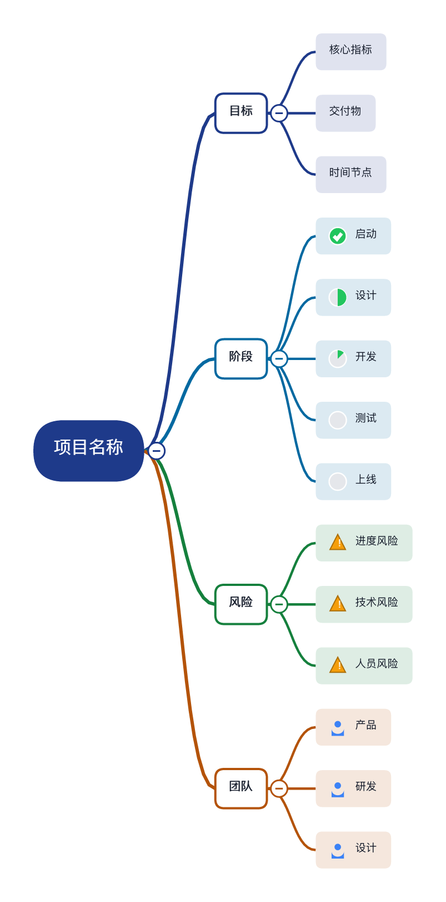

# XMind-RS — 开源思维导图（Rust 实现）

一个用 Rust 从零实现的开源思维导图应用：**完全本地运行、无账号、无订阅、无遥测**。
与 XMind 的 `.xmind` 文件格式互通，可以直接打开官方文件，官方 XMind 也能打开本软件保存的文件。

> 本项目为个人开源重实现，与 XMind Ltd. 无任何关联；"XMind" 名称仅用于文件格式兼容性说明。



## 功能总览

### 导图结构（9 种）
思维导图（逻辑右）、逻辑图（左）、双向导图、组织结构图（上/下）、树形图、时间线、鱼骨图、矩阵图。
每个主题都可以单独指定其子级的结构，一张图里可混用多种结构。

### 编辑
- Tab 建子主题、Enter 建同级、F2/双击就地编辑、Delete 删除
- 拖拽主题自由摆放；**拖到其他主题上即移动为其子主题**；Shift+拖拽空白框选
- 展开/收起（点击节点旁的小圆钮）、全部展开/收起
- 插入上级主题（把当前主题包一层）
- 自由主题（浮动节点）、撤销/重做（120 步）
- 复制/剪切/粘贴整个子树；粘贴缩进文本自动生成子树

### 内容元素
- 标记：优先级 P1–P9、任务进度（饼图 0–100%）、红旗/星标/人物/爱心/表情/符号，全部矢量绘制
- 标签（多色小胶囊）、备注（面板编辑）、超链接（⌘+双击打开）
- 联系线（任意两主题间曲线、箭头、虚线、标签）
- 外框（同级范围框选 + 标签）、概要（大括号 + 概要主题，可再挂子主题）
- 插入图片（PNG/JPG，嵌入文档）

### 样式与主题
- 9 套内置主题：经典蓝 / 清新绿 / 樱花粉 / 暗夜 / 商务蓝 / 素雅灰 / 活力橙 / 紫罗兰 / 纯白
- 每主题独立设置；节点级样式覆盖：填充色、文字色、边框、形状（圆角/直角/下划线/胶囊/椭圆/菱形）、字号、加粗

### 视图与效率
- 无限画布：触控板平移、⌘+滚轮/双指缩放、适应画布、100%
- 大纲面板（与画布双向同步、可编辑）
- 属性面板（标记/样式/结构/标签/备注/链接/图片一站式编辑）
- 查找替换（正文 + 备注，逐个跳转 / 全部替换）
- 下钻（聚焦某个分支临时成图，面包屑导航）
- 演示模式（⌘P，←/→ 按深度优先顺序翻页，其余内容暗化）
- 多画布（页签：新建/复制/删除/重命名）
- 自动保存（每 25 秒，崩溃/误关后启动时可恢复）+ 最近文件
- 中文 / English 界面切换
- 拖入 `.xmind/.md/.opml/.mm/.txt` 文件直接打开

### 文件与导入导出
| 方向 | 格式 |
|---|---|
| 打开/保存 | `.xmind`（XMind Zen/2020+ JSON 格式，官方可打开）；可读 XMind 8 legacy `content.xml` |
| 导入 | Markdown（标题+列表）、OPML、FreeMind `.mm`、缩进纯文本 |
| 导出 | PNG(2x)、SVG、PDF、Markdown、纯文本、OPML、FreeMind、HTML、Word `.docx`、Excel `.xlsx` |

无损往返说明：保存时在 zip 内附带 `xmindrs.json`（完整模型），本软件重新打开时优先读取它，
保证外框/概要/样式零丢失；官方 XMind 读取标准 `content.json` 部分。

### 内置模板
空白图、头脑风暴、项目计划、读书笔记、一周安排、会议纪要、时间线、鱼骨图。

## 快速开始

### 直接下载

[GitHub Release](https://github.com/wooluo/XMind-rs/releases/latest) 提供 macOS（Apple Silicon .app）、Windows x64、Linux x64 预编译包。

### 从源码构建

```bash
# GUI（开发构建）
cargo run -p xmind-app

# GUI（发布构建，推荐日常使用）
cargo build --release -p xmind-app
./target/release/xmind-rs            # 或把二进制加到 /Applications
./target/release/xmind-rs 某文件.xmind  # 直接打开文件
# Linux 构建需要 GTK/图形库依赖：
#   Debian/Ubuntu: sudo apt install libgtk-3-dev libxkbcommon-dev libwayland-dev

# 命令行（无头转换 / 渲染）
cargo run -p xmind-cli -- new -o plan.xmind -t project
cargo run -p xmind-cli -- convert plan.xmind plan.md
cargo run -p xmind-cli -- render plan.xmind -o plan.png --scale 2
cargo run -p xmind-cli -- info plan.xmind
cargo run -p xmind-cli -- templates
```

macOS 首次运行如被 Gatekeeper 拦截：`xattr -cr ./target/release/xmind-rs`。

## 快捷键

| 按键 | 功能 |
|---|---|
| Tab / Enter | 子主题 / 同级主题（并进入编辑） |
| F2 / Space / 双击 | 编辑当前主题 |
| Delete | 删除（含子树） |
| ↑ ↓ / ← → | 同级切换 / 父↔子导航 |
| 右键 | 完整菜单（插入/标记/样式/结构/方向/下钻…） |
| ⌘Z / ⌘⇧Z | 撤销 / 重做 |
| ⌘C / ⌘X / ⌘V | 复制 / 剪切 / 粘贴子树 |
| ⌘A | 全选 |
| ⌘F | 查找替换 |
| ⌘S / ⌘O / ⌘N | 保存 / 打开 / 新建 |
| ⌘P | 演示模式 |
| ⌘ +/-/0 | 缩放 / 100% |
| Esc | 取消编辑 / 退出下钻 / 清除选择 |

## 工程结构

```
crates/
  xmind-core/    文档模型 · 9 种布局引擎 · 场景图元 · .xmind 读写 · 导入导出 · 模板
  xmind-app/     egui 桌面应用（画布交互 / 面板 / 快捷键 / 自动保存 / i18n）
  xmind-cli/     无头 CLI（new / convert / render / info）
```

渲染架构：core 产出与渲染器无关的图元列表（Rect/Poly/Circle/Text/Tris/Image），
GUI 用 egui 绘制，PNG/PDF 用 tiny-skia + ab_glyph 栅格化，SVG 直接生成矢量文本 ——
屏幕与导出共享同一套布局与测量逻辑（`TextMeasurer` trait）。

字体：自动发现系统 CJK 字体（macOS: Hiragino Sans GB / PingFang SC，
Windows: 微软雅黑，Linux: Noto Sans CJK），并对无法取轮廓的受保护字体自动跳过。

## 测试

```bash
cargo test --workspace   # 16 个单元/集成测试：树操作、撤销、布局不重叠、格式往返、渲染冒烟
```

## 未实现（与官方 XMind 的差距，诚实列表）

- 云同步 / 多人协作 / 分享链接 / AI —— 订阅功能，按需求明确不做
- 甘特图、泳道图、对话式气泡结构
- 贴纸素材库（官方素材有版权）、音频备注、LaTeX 公式
- 演示模式的转场动画 / Pitch 深度定制
- Word/Excel 的导入（只做导出）
- PDF 里的文字为高分辨率位图（未嵌入字体子集，CJK 场景下最稳妥）

## License

MIT（见 [LICENSE](LICENSE)）。与 XMind Ltd. 无关联，仅供个人学习与使用。
